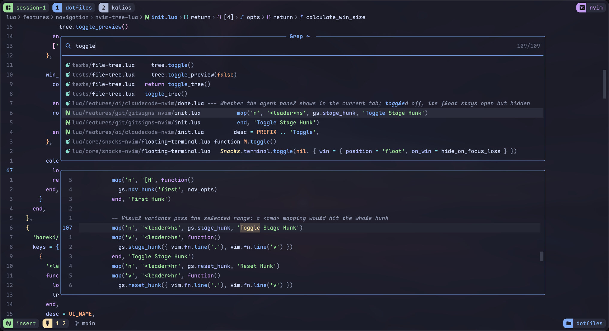
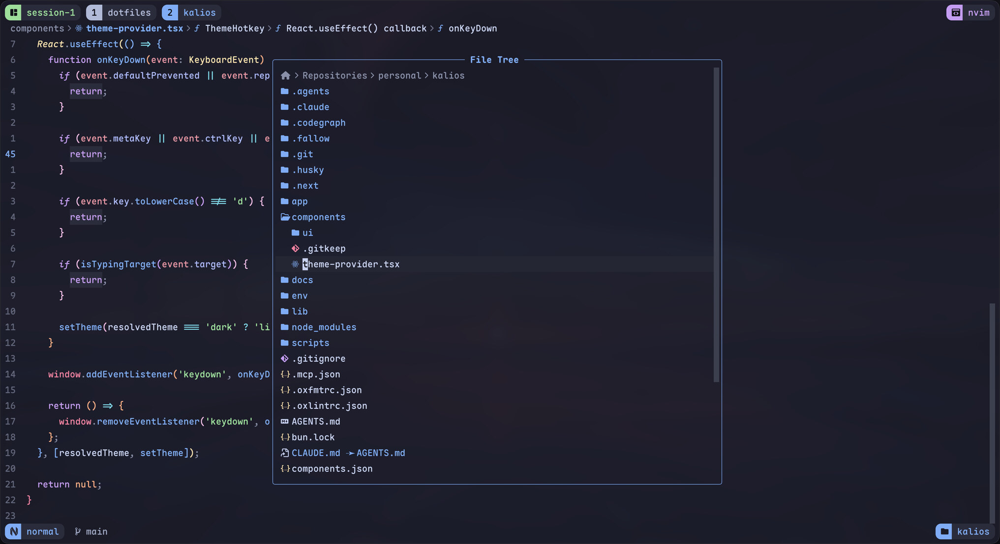
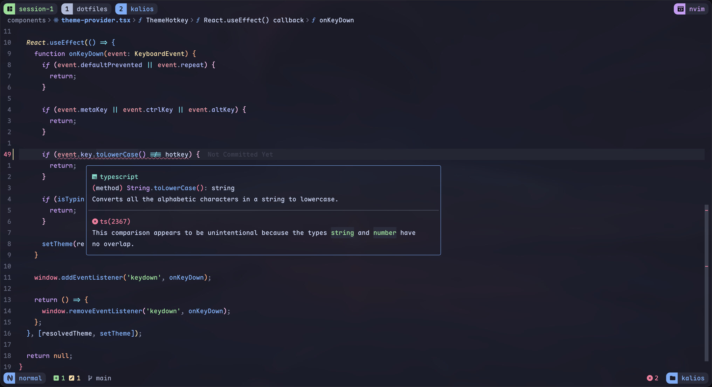
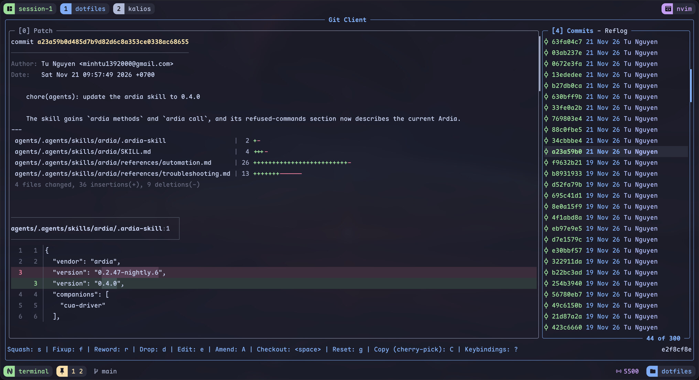
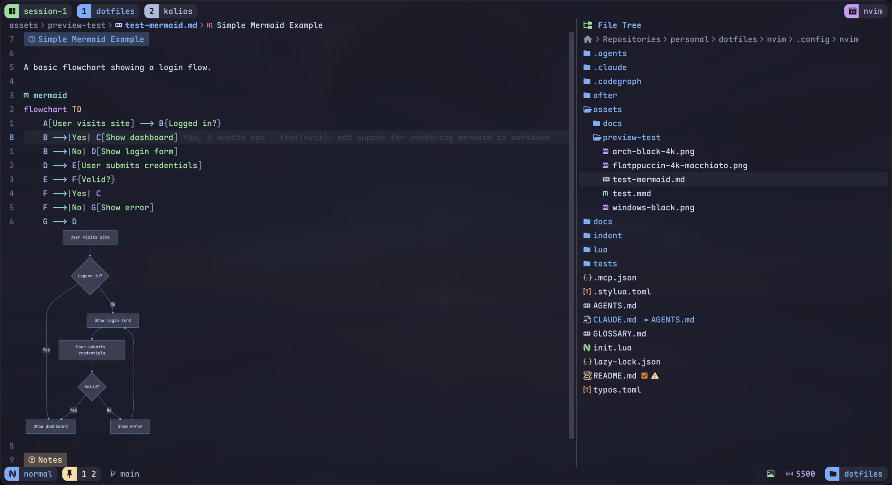

<h1 align="center">hareki's Neovim config</h1>

<hr>

<h4 align="center">
  <a href="#-getting-started">Install</a>
  ·
  <a href="#-plugins">Plugins</a>
  ·
  <a href="#-docs">Docs</a>
</h4>

<div align="center"><p>
    <a href="https://github.com/neovim/neovim/releases/tag/stable">
      
    </a>
    <a href="#-what-is-it">
      
    </a>
    <a href="https://github.com/hareki/dotfiles/commits/main/nvim">
      
    </a>
    <a href="https://github.com/hareki/dotfiles/blob/main/LICENSE.md">
      
    </a>
</p></div>

A Neovim config written from scratch on [💤 lazy.nvim](https://github.com/folke/lazy.nvim).
It is not a distro and has no options layer for other people: every plugin gets its own spec
file, every float shares one layout, and the plugins that needed changes run from small forks
that stay rebased on upstream.

## ✨ Features

- 🚀 Starts in ~28ms with no file, \~47ms on a small Lua file, \~140ms on a TypeScript file (`:Lazy profile`)
- 🪟 One floating layout for the Snacks picker, the file tree and their previews
- ⌨️ <kbd>Tab</kbd> moves focus between a list and its preview, <kbd>Ctrl-t</kbd> docks a float as a side panel
- 🤖 Claude Code in a full-screen terminal, next-edit predictions and AI completion items
- 🧠 TypeScript errors rendered as readable Markdown in the diagnostic hover
- 🎨 Catppuccin Mocha everywhere, with one color per mode on the statusline and the cursor line number
- 🍴 26 plugin forks, each a few commits on top of upstream

## 🤔 What is it?

- A personal config built for one machine (macOS, Ghostty, mise, Homebrew). It is public so the
  ideas can be borrowed, not installed as is.

- Each plugin has one spec file or directory under `lua/{core,chrome,features}/`. A feature built
  on Neovim alone (the mode colors, the trackpad axis lock, the highlight inspector) is a
  `virtual = true` spec filed the same way, so `:Lazy` lists it and it loads on its own trigger.

- Almost everything loads on a keymap, a command or `VeryLazy`. Startup turns the LuaJIT
  compiler off until `VimEnter` and enables `vim.loader`.

- Where a plugin could not do what the config needed, I forked it instead of patching it from the
  outside. Each fork is upstream's default branch plus a few commits, rebased by the `sync-forks`
  zsh function, and its additions sit behind options, so turning them off gives upstream's
  behavior.

## 📸 Showcase

### Snacks picker

Every picker opens in one centered float, sized from the shared table in `config/size.lua`. The
preview sits under the list, so a grep match keeps its whole line, and <kbd>Tab</kbd> moves focus
into the preview and back.



### File tree

nvim-tree opens as a float in the same frame as the pickers. <kbd>Ctrl-t</kbd> docks it as a side
panel, as in the Mermaid shot below.



### Diagnostic hover

eagle.nvim puts the LSP hover and the diagnostic under the cursor in one float. TypeScript errors
pass through `pretty-ts-errors-markdown`, so the types in the message render as code.



### Lazygit with codediff

<kbd>Alt-g</kbd> opens lazygit full screen. With the [lazygit config](../lazygit/) from these
dotfiles, its diff panel is drawn by codediff.nvim's diff engine, which a headless Neovim daemon
runs, so lazygit gets the same character-level highlights as codediff's own view.



### Images in the buffer

A Mermaid block in Markdown renders as a diagram under its code, through Snacks and the kitty
graphics protocol. <kbd>g</kbd><kbd>i</kbd> shows any image path under the cursor in a float.



## ⚡️ Requirements

- **[Neovim](https://neovim.io/) 0.12+**, for the native `vim.lsp.enable()` API
- **[Git](https://git-scm.com/)**, used by gitsigns.nvim, lazygit and blink-ripgrep's gitgrep backend
- **[Nerd Font](https://www.nerdfonts.com/)**: every icon is a Nerd Font glyph
- **[Ghostty](https://ghostty.org/)** or another terminal with the kitty graphics protocol, for images
- **[ripgrep](https://github.com/BurntSushi/ripgrep)** and **[fd](https://github.com/sharkdp/fd)** for the picker
- **[lazygit](https://github.com/jesseduffield/lazygit)**, opened full screen with <kbd>Alt-g</kbd>
- **[delta](https://github.com/dandavison/delta)**, for diff previews in tiny-code-action.nvim
- **[ImageMagick](https://imagemagick.org/)**, for the `magick` CLI that Snacks' image rendering calls
- **[mermaid-cli](https://github.com/mermaid-js/mermaid-cli)** (`mmdc`), to render Mermaid diagrams
- **[tree-sitter CLI](https://github.com/tree-sitter/tree-sitter)** and a C compiler, to build parsers
- **[Go](https://go.dev/)**, to build cursortab.nvim's server
- **[mise](https://mise.jdx.dev/)** with Node.js, which installs the Node-based language servers, oxfmt, oxlint, prettier and `pretty-ts-errors-markdown` from `~/.config/mise/config.toml`
- **[Homebrew](https://brew.sh/)** for lua-language-server, marksman, taplo, typos-lsp and stylua

<details><summary>API keys and subscriptions</summary>

- **`ANTHROPIC_API_KEY`**: commit messages in ai-commit-msg.nvim
- **`MERCURY_API_KEY`**: Inception Labs Mercury, for cursortab.nvim's next-edit predictions and minuet-ai.nvim's completion items
- **[Claude Code](https://claude.ai/download)** CLI and a subscription, for claudecode.nvim (<kbd>Alt-a</kbd>)

</details>

## 🚀 Getting Started

The config lives in my [dotfiles](https://github.com/hareki/dotfiles), which
[GNU Stow](https://www.gnu.org/software/stow/) links into `$HOME`.

<details><summary>Install with Stow</summary>

- Back up your current Neovim files:

  ```sh
  mv ~/.config/nvim ~/.config/nvim.bak
  mv ~/.local/share/nvim ~/.local/share/nvim.bak
  ```

- Clone the dotfiles and link the `nvim` package:

  ```sh
  git clone https://github.com/hareki/dotfiles ~/dotfiles
  stow -d ~/dotfiles -t ~ nvim
  ```

- Start Neovim. lazy.nvim installs the plugins from `lazy-lock.json` on the first run:

  ```sh
  nvim
  ```

</details>

## 📦 Plugins

Plugins marked **fork** run from a `hareki/*` fork of the linked repository.

### Core

- Plugin management with [lazy.nvim](https://github.com/folke/lazy.nvim) ([fork](https://github.com/hareki/lazy.nvim))
- Colorscheme with [catppuccin/nvim](https://github.com/catppuccin/nvim), Mocha flavor
- Icons with [mini.icons](https://github.com/echasnovski/mini.icons)
- Syntax highlighting and text objects with [nvim-treesitter](https://github.com/nvim-treesitter/nvim-treesitter) and [nvim-treesitter-textobjects](https://github.com/nvim-treesitter/nvim-treesitter-textobjects), plus forked SCSS and Glimmer parsers
- Sessions per directory with [auto-session](https://github.com/rmagatti/auto-session) ([fork](https://github.com/hareki/auto-session))
- Picker, terminals, images, zen mode and lazygit with [snacks.nvim](https://github.com/folke/snacks.nvim) ([fork](https://github.com/hareki/snacks.nvim)), split into one fragment per feature

### LSP

- Server configs with [nvim-lspconfig](https://github.com/neovim/nvim-lspconfig) and the native `vim.lsp.enable()`
- Lua library types with [lazydev.nvim](https://github.com/folke/lazydev.nvim)
- Stopping idle servers with [garbage-day.nvim](https://github.com/Zeioth/garbage-day.nvim) ([fork](https://github.com/hareki/garbage-day.nvim))
- Code actions with diff previews with [tiny-code-action.nvim](https://github.com/rachartier/tiny-code-action.nvim)
- Format, lint fixes and save on one key with [conform.nvim](https://github.com/stevearc/conform.nvim)

### UI

- Statusline with [lualine.nvim](https://github.com/nvim-lualine/lualine.nvim) and its own components (mode, branch, buffer status, macro, repo name)
- Breadcrumbs with [dropbar.nvim](https://github.com/Bekaboo/dropbar.nvim) ([fork](https://github.com/hareki/dropbar.nvim))
- Cmdline and messages with [noice.nvim](https://github.com/folke/noice.nvim) ([fork](https://github.com/hareki/noice.nvim)) and [nvim-notify](https://github.com/rcarriga/nvim-notify) ([fork](https://github.com/hareki/nvim-notify))
- Folds with [nvim-ufo](https://github.com/kevinhwang91/nvim-ufo)
- Scrollbar with diagnostic and search marks with [satellite.nvim](https://github.com/lewis6991/satellite.nvim) ([fork](https://github.com/hareki/satellite.nvim))
- Key hints with [which-key.nvim](https://github.com/folke/which-key.nvim) ([fork](https://github.com/hareki/which-key.nvim))
- Bracket colors with [rainbow-delimiters.nvim](https://github.com/HiPhish/rainbow-delimiters.nvim) and [matchparen.nvim](https://github.com/monkoose/matchparen.nvim)
- Color previews with [nvim-colorizer.lua](https://github.com/catgoose/nvim-colorizer.lua)

### Editing

- Completion with [blink.cmp](https://github.com/saghen/blink.cmp), plus [blink-ripgrep.nvim](https://github.com/mikavilpas/blink-ripgrep.nvim) ([fork](https://github.com/hareki/blink-ripgrep.nvim)), [blink-cmp-conventional-commits](https://github.com/disrupted/blink-cmp-conventional-commits), [blink-cmp-dat-word](https://github.com/xieyonn/blink-cmp-dat-word) and [cmp-cmdline-history](https://github.com/dmitmel/cmp-cmdline-history) through [blink.compat](https://github.com/saghen/blink.compat)
- Comments with [Comment.nvim](https://github.com/numToStr/Comment.nvim) ([fork](https://github.com/hareki/comment.nvim))
- Text objects and surrounds with [mini.ai](https://github.com/nvim-mini/mini.ai) ([fork](https://github.com/hareki/mini.ai)) and [mini.surround](https://github.com/nvim-mini/mini.surround) ([fork](https://github.com/hareki/mini.surround))
- Jumps with [flash.nvim](https://github.com/folke/flash.nvim), subword motions with [nvim-spider](https://github.com/chrisgrieser/nvim-spider)
- Multiple cursors with [multicursor.nvim](https://github.com/jake-stewart/multicursor.nvim)
- Yank history with [yanky.nvim](https://github.com/gbprod/yanky.nvim) ([fork](https://github.com/hareki/yanky.nvim))
- Pairs and tags with [nvim-autopairs](https://github.com/windwp/nvim-autopairs) and [ts-autotag.nvim](https://github.com/tronikelis/ts-autotag.nvim)
- Indent detection with [guess-indent.nvim](https://github.com/NMAC427/guess-indent.nvim)

### Navigation and search

- File tree with [nvim-tree.lua](https://github.com/nvim-tree/nvim-tree.lua) ([fork](https://github.com/hareki/nvim-tree.lua)) and [nvim-tree-preview.lua](https://github.com/b0o/nvim-tree-preview.lua) ([fork](https://github.com/hareki/nvim-tree-preview.lua))
- File marks with [harpoon](https://github.com/ThePrimeagen/harpoon) (`harpoon2`)
- Window moves that carry on into the next Rex pane at the edge, from a `virtual = true` spec (`window-navigation`)
- Search and replace with [grug-far.nvim](https://github.com/MagicDuck/grug-far.nvim) ([fork](https://github.com/hareki/grug-far.nvim))
- Match counts with [nvim-hlslens](https://github.com/kevinhwang91/nvim-hlslens), selection matches with [visimatch.nvim](https://github.com/wurli/visimatch.nvim)
- TODO comments with [todo-comments.nvim](https://github.com/folke/todo-comments.nvim)

### Git

- Hunks and blame with [gitsigns.nvim](https://github.com/lewis6991/gitsigns.nvim) ([fork](https://github.com/hareki/gitsigns.nvim))
- Diffs with [codediff.nvim](https://github.com/esmuellert/codediff.nvim) ([fork](https://github.com/hareki/codediff.nvim))
- Conflicts with [git-conflict.nvim](https://github.com/akinsho/git-conflict.nvim) ([fork](https://github.com/hareki/git-conflict.nvim))

### Diagnostics and preview

- Diagnostic lists with [trouble.nvim](https://github.com/folke/trouble.nvim) ([fork](https://github.com/hareki/trouble.nvim))
- Diagnostic hovers with [eagle.nvim](https://github.com/soulis-1256/eagle.nvim) ([fork](https://github.com/hareki/eagle.nvim))
- Print debugging with [debugprint.nvim](https://github.com/andrewferrier/debugprint.nvim)
- Markdown with [render-markdown.nvim](https://github.com/MeanderingProgrammer/render-markdown.nvim) in the buffer and [live-preview.nvim](https://github.com/brianhuster/live-preview.nvim) ([fork](https://github.com/hareki/live-preview.nvim)) in the browser

### AI

- Claude Code with [claudecode.nvim](https://github.com/coder/claudecode.nvim) ([fork](https://github.com/hareki/claudecode.nvim))
- Next-edit predictions with [cursortab.nvim](https://github.com/cursortab/cursortab.nvim) ([fork](https://github.com/hareki/cursortab.nvim))
- AI completion items with [minuet-ai.nvim](https://github.com/milanglacier/minuet-ai.nvim)
- Commit messages with [ai-commit-msg.nvim](https://github.com/aweis89/ai-commit-msg.nvim) ([fork](https://github.com/hareki/ai-commit-msg.nvim))

### Built on Neovim alone

- **mode-colors**: the cursor line number takes the mode's color from lualine's mode pill
- **focus-cursorline**: the cursor line follows the focused window, the others keep only its number
- **wheel-axis-lock**: locks each trackpad swipe to one axis, as browsers do
- **hl-at-cursor**: a float of the highlight groups, captures and extmarks under the cursor
- **integration-statusline**: replaces lualine with a label when git, lazygit or Claude Code opens Neovim as its editor

## 📂 File Structure

<pre>
~/.config/nvim
├── init.lua              boot order, then lazy.nvim
├── lua
│   ├── config            options, keymaps, autocmds, icons, sizes, the globals
│   ├── core              lazy.nvim, colorscheme, treesitter, LSP, sessions, Snacks
│   ├── chrome            statusline, breadcrumbs, messages, folds, scrollbar, which-key
│   ├── features          ai, completion, diagnostics, editing, formatting, git,
│   │                     navigation, preview, search
│   └── utils             the UI, Notifier and Defer globals, popups, keymap helpers
├── after                 ftplugins and query overrides
├── docs                  conventions and the testing guide
└── tests                 headless tests and the config A/B diff
</pre>

A plugin with helper logic uses the directory form:

<pre>
nvim-tree-lua/
├── init.lua    the lazy.nvim specs, nothing else
└── utils.lua   helpers, and the plugin's state table if it keeps one
</pre>

## 📚 Docs

**[docs/architecture.md](./.config/nvim/docs/architecture.md)** covers how the config boots, where code
lives, and which modules other tools reach into.

The conventions for each kind of change live in [`docs/conventions/`](./.config/nvim/docs/conventions/):

- **[code-style.md](./.config/nvim/docs/conventions/code-style.md)**: annotations, requires, constants, augroups, notifications, file names
- **[plugin-specs.md](./.config/nvim/docs/conventions/plugin-specs.md)**: where a spec goes and which spec owns an option, key or autocmd
- **[split-plugins.md](./.config/nvim/docs/conventions/split-plugins.md)**: snacks.nvim's per-feature fragments
- **[keymaps.md](./.config/nvim/docs/conventions/keymaps.md)**: defining a keymap, `desc` title case, which-key groups
- **[ui.md](./.config/nvim/docs/conventions/ui.md)**: icons, colors, highlights and float sizes
- **[lsp.md](./.config/nvim/docs/conventions/lsp.md)**: enabling a language server, and which servers run per project
- **[forks.md](./.config/nvim/docs/conventions/forks.md)**: the `hareki/*` forks and which fixes belong in one

**[docs/testing.md](./.config/nvim/docs/testing.md)** covers the three test scripts: `tests/run.sh` runs the headless
tests, `tests/ab.sh` diffs what two revisions of the config define (maps, highlights, autocmds,
options, plugin opts), and `tests/probe.sh` runs a one-off Lua payload in the same boot.

## 🙏 Credits

Inspired by [kickstart.nvim](https://github.com/nvim-lua/kickstart.nvim), [LazyVim](https://github.com/LazyVim/LazyVim) and [NvChad](https://github.com/NvChad/NvChad).
