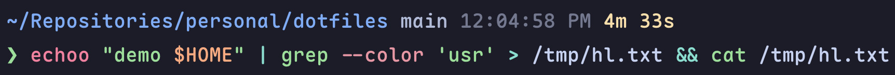

<h1 align="center">hareki's zsh config</h1>

<hr>

<h4 align="center">
  <a href="#-getting-started">Install</a>
  ·
  <a href="#-plugins">Plugins</a>
  ·
  <a href="#-docs">Docs</a>
</h4>

<div align="center"><p>
    <a href="#-what-is-it">
      
    </a>
    <a href="https://github.com/hareki/dotfiles/commits/main/zsh">
      
    </a>
    <a href="https://github.com/hareki/dotfiles/blob/main/LICENSE.md">
      
    </a>
</p></div>

A zsh config for macOS that reaches a usable prompt in ~45ms (~25ms for `zsh -i -c exit`).
Antidote bundles the plugins into one static file, tool init output is cached and compiled, and
functions load on their first call.



## ✨ Features

- 🚀 ~45ms to the first prompt, with every startup override measured in [startup-overrides.md](docs/startup-overrides.md)
- 📦 One static [Antidote](https://github.com/mattmc3/antidote) bundle, with fzf-tab and autosuggestions deferred
- 🗄️ A local `_evalcache` for zoxide, atuin, wt and zsh-patina, compiled with `zcompile`
- ⌨️ Vi mode with OSC52 yank, so copying works over SSH
- 🔑 API keys read from the macOS keychain instead of a dotfile
- 🎨 Catppuccin Mocha across fzf, zsh-patina and eza

## 🤔 What is it?

- A personal config for one machine: macOS, Homebrew at `/opt/homebrew/`, Ghostty sending
  <kbd>Cmd</kbd> as <kbd>Alt</kbd>.

- It loads six oh-my-zsh libs instead of the framework, and runs every expensive `eval` once:
  the output is cached to a file and compiled to bytecode on first run.

- Tests boot the config in scratch shells with a throwaway HOME and dummy keys. `tests/ab.zsh`
  boots a past revision and the working tree and diffs everything each one defines, so a refactor
  can show it changed nothing.

## ⚡️ Requirements

- **macOS** with **[Homebrew](https://brew.sh/)** at `/opt/homebrew/`
- **[Antidote](https://github.com/mattmc3/antidote)** and **[zsh-patina](https://github.com/michel-kraemer/zsh-patina)** from Homebrew
- **[fzf](https://github.com/junegunn/fzf)**, **[zoxide](https://github.com/ajeetdsouza/zoxide)**, **[atuin](https://github.com/atuinsh/atuin)**, **[eza](https://github.com/eza-community/eza)** and **[worktrunk](https://worktrunk.dev)** (`wt`)
- **[mise](https://mise.jdx.dev/)** for the language toolchains
- **[Nerd Font](https://www.nerdfonts.com/)** for the prompt and eza icons

## 🚀 Getting Started

The config lives in my [dotfiles](https://github.com/hareki/dotfiles), which
[GNU Stow](https://www.gnu.org/software/stow/) links into `$HOME`.

<details><summary>Install with Stow</summary>

- Back up your current `~/.zshenv` and `~/.zshrc`
- Clone the dotfiles and link the `zsh` package:

  ```sh
  git clone https://github.com/hareki/dotfiles ~/dotfiles
  stow -d ~/dotfiles -t ~ zsh
  ```

- Open a new shell. The first one builds the Antidote bundle and the eval cache.

</details>

## 📦 Plugins

- Prompt with [powerlevel10k](https://github.com/romkatv/powerlevel10k)
- Fuzzy tab completion with [fzf-tab](https://github.com/Aloxaf/fzf-tab) (deferred)
- History suggestions with [zsh-autosuggestions](https://github.com/zsh-users/zsh-autosuggestions) (deferred)
- Syntax highlighting with [zsh-patina](https://github.com/michel-kraemer/zsh-patina), a Homebrew binary with a background daemon
- Completion, history, key bindings and terminal titles from six [oh-my-zsh](https://github.com/ohmyzsh/ohmyzsh) libs

## 🧰 Commands

- **`sync-dots`**: stow one package, several, or `all`
- **`sync-forks`**: rebase every `hareki/*` fork onto its upstream
- **`build`**: build atuin, eza, television, worktrunk, lazygit, fzf and tmux from source
- **`yay`**: update Homebrew, Antidote, mise, the agent skills and TPM in one go
- **`tsave`** / **`trestore`**: snapshot every tmux session and quit it cleanly, then restore it
- **`mux`**: run a tmuxinator layout at the terminal's real size
- **`ctb`** / **`cts`**: toggle Claude Code's done bell, and whether git tracks its `settings.json`

## 📂 File Structure

<pre>
~
├── .zshenv               every shell: XDG dirs, keychain secrets, PATH, mise shims
├── .zshrc                interactive shells: prompt, plugins, the modules below
├── .zplugins             the Antidote manifest
└── .config/zsh
    ├── plugins.zsh       Antidote setup and plugin options
    ├── options.zsh       environment, fzf theme and layout
    ├── completion.zsh    compinit and its dump
    ├── evals.zsh         zoxide, atuin, wt and zsh-patina init through _evalcache
    ├── keymaps.zsh       key bindings
    ├── vi-mode.zsh       vi mode, OSC52 yank, clipboard paste
    ├── aliases.zsh       aliases
    ├── tty-guard.zsh     repairs a tty left in cooked mode under zle
    ├── compdefs/         completions, one per command family
    └── functions/        autoloaded functions, one per file
</pre>

## 📚 Docs

- **[startup.md](docs/conventions/startup.md)**: what a shell runs at startup, where a new line goes, and measuring it
- **[commands.md](docs/conventions/commands.md)**: writing, wrapping and completing a command
- **[startup-overrides.md](docs/startup-overrides.md)**: the reason and the measured cost behind each override
- **[testing.md](docs/testing.md)**: `tests/run.zsh` for the test files, `tests/ab.zsh` to diff a revision against the working tree
